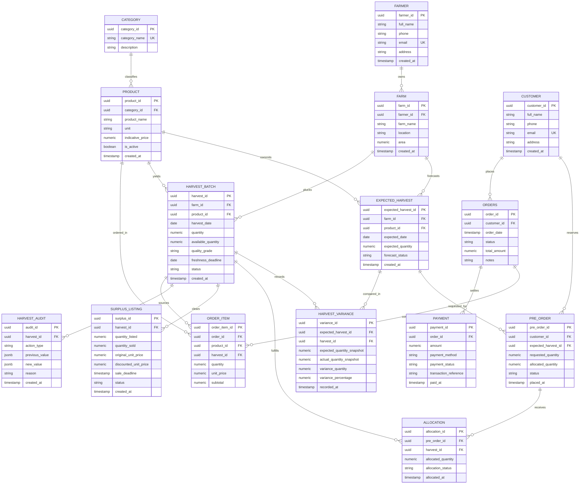

# FreshHarvest: Local Farmer Market Management System
## Academic Project Report & Database Architecture Specification

**Student Name:** JIBIN V JOHNSON  
**Roll No:** 15  
**Degree:** Bachelor of Technology (B.Tech)  
**Institution:** Amal Jyothi College of Engineering  
**Department:** Computer Science and Engineering  
**Course:** Database Management Systems (DBMS) Capstone Laboratory  

---

## 1. Abstract
Agricultural market platforms frequently suffer from severe supply mismatches between anticipated crop yields and actual harvested quantities. Traditional e-commerce models operate under the assumption of stable factory inventory, leading to overbooking, cancelled consumer orders, unfair distribution during crop shortfalls, and substantial post-harvest food waste when unexpected surpluses occur.

**FreshHarvest** is a full-stack, relational database-driven platform built on Next.js 15, TypeScript, Tailwind CSS, and PostgreSQL / Supabase. FreshHarvest introduces a novel agricultural supply pipeline: **Expected Harvest $\to$ Customer Pre-Orders $\to$ Actual Harvest $\to$ Fair Stock Allocation $\to$ Order Fulfilment $\to$ Surplus Rescue**. The system enforces mathematical invariants ensuring that customer allocations never exceed verified harvest quantities, calculates audited harvest variance, provides deterministic stock allocation policies (FIFO and Proportional), enables time-decayed surplus produce rescue, and records an immutable audit trail (`HARVEST_AUDIT`).

---

## 2. Introduction & Problem Statement

### 2.1 Problem Statement
Smallholder agricultural marketing faces four systemic hurdles:
1. **Harvest Yield Uncertainty:** Biological variation and seasonal weather make exact yield prediction impossible. Farmers frequently over-commit or experience shortfalls.
2. **Unfair Allocation & Overbooking:** When harvest yields fall short of pre-orders, traditional platforms either silently cancel orders without explanation or allocate arbitrarily, alienating loyal consumers.
3. **Surplus Spoilage:** When physical harvest exceeds advance demand, excess perishable produce rots due to lack of immediate, discounted consumer clearance channels.
4. **Data Inconsistency:** Manual logbooks lack referential integrity, enabling negative quantities, orphan records, and historical tampering.

---

## 3. Comparison: Existing Systems vs. FreshHarvest

| Dimension | Existing Farm Direct / E-Commerce Platforms | FreshHarvest Proposed System |
|---|---|---|
| **Inventory Source** | Static warehouse assumptions | Dynamic two-stage pipeline (Forecast Commitment $\to$ Verified Batch) |
| **Shortfall Handling** | Random cancellation, overselling | Deterministic allocation policy (FIFO / Proportional) with transparent shortage calculation |
| **Commitment Auditing** | None; forecasts are discarded | Point-in-time snapshot variance table (`HARVEST_VARIANCE`) |
| **Surplus Handling** | Often dumped or unlisted | Real-time surplus listing with automated expiry and discount pricing |
| **Database Integrity** | Loose NoSQL or unnormalized schemas | 3NF PostgreSQL schema with foreign keys, CHECK constraints, and triggers |

---

## 4. System Objectives & Mathematical Formulations

### 4.1 Harvest Promise Formula
$$\Delta Q = Q_{actual} - Q_{expected}$$
$$V_{\%} = \begin{cases} 
0\% & \text{if } Q_E = 0 \text{ and } Q_A = 0 \\
+100\% & \text{if } Q_E = 0 \text{ and } Q_A > 0 \\
\left(\frac{Q_A - Q_E}{Q_E}\right) \times 100 & \text{if } Q_E > 0 
\end{cases}$$

### 4.2 Stock Allocation Invariant
$$\sum_{i=1}^{m} \text{AllocatedQuantity}_i \le \text{AvailableHarvestStock}$$
The total stock allocated to customer pre-orders must never exceed the actual confirmed harvest quantity.

---

## 5. Entity-Relationship (ER) Model

---

## 6. Relational Normalization (1NF, 2NF, 3NF Analysis)

### 6.1 First Normal Form (1NF)
- **Atomic Values:** Every column in the 15 relations holds only indivisible, atomic values. No comma-delimited strings or multi-valued attributes exist.
- **Unique Identification:** Every tuple is uniquely identified by a single primary surrogate key (`UUID`).

### 6.2 Second Normal Form (2NF)
- **Functional Dependencies:** A relation is in 2NF if it is in 1NF and no non-prime attribute is partially dependent on any candidate key.
- In FreshHarvest, tables with composite natural relationships (e.g., `ORDER_ITEM`, `ALLOCATION`) use surrogate primary keys where every non-key attribute is fully functionally dependent on the primary key:
  - $\text{order\_item\_id} \to (\text{order\_id}, \text{product\_id}, \text{quantity}, \text{unit\_price}, \text{subtotal})$
  - Neither `quantity` nor `unit_price` depends on a subset of the primary key.

### 6.3 Third Normal Form (3NF)
- A relation is in 3NF if it is in 2NF and has no transitive dependencies ($X \to Y$ and $Y \to Z$ where $Z$ is non-prime).
- **Transitive Dependency Elimination Examples:**
  - `PRODUCT` holds `category_id`, but does NOT store `category_name` or `description`. Storing both would create $product\_id \to category\_id \to category\_name$. `CATEGORY` was separated into an independent relation.
  - `FARM` references `farmer_id`, but does not replicate the farmer's personal contact details (`phone`, `email`, `address`).
  - `ORDER_ITEM` records `unit_price` strictly as a point-in-time transaction snapshot to prevent historical order corruption when catalog prices change.

---

## 7. The Critical Shortfall Demonstration Scenario

To verify that the system handles crop deficits robustly, FreshHarvest embeds an explicit benchmark scenario:
1. **Farmer:** Thomas Kurian (Green Valley Organic Estate).
2. **Crop:** Organic Country Tomatoes.
3. **Expected Harvest Forecast:** 100 kg.
4. **Valid Pre-Orders Placed:**
   - Alice Mathew: 35 kg (09:00 AM)
   - Bob K. Joseph: 35 kg (10:15 AM)
   - Catherine Thomas: 20 kg (11:30 AM)
   - **Total Demand:** 90 kg.
5. **Actual Harvest Weighed:** 70 kg.
6. **Execution Outcome:**
   - Variance: $70 - 100 = -30$ kg (-30.00% shortfall).
   - Alice receives full 35 kg.
   - Bob receives full 35 kg.
   - Total allocated = 70 kg (100% of actual batch yield).
   - Catherine receives 0 kg with an explicit 20 kg shortfall.
   - Batch stock remaining = 0 kg; no ghost inventory overselling.

---

## 8. Automated Testing & Verification
FreshHarvest includes an automated Vitest test suite (`tests/business-logic.test.ts`) covering all 14 required cases:
- Shortfall & surplus variance calculations.
- Zero expected quantity safe division.
- FIFO and Proportional allocation previews and executions.
- Invariant assertions: Allocated $\le$ Available.
- Rejection of invalid negative quantities.
- Surplus auto-expiration and inventory limits.
- Server-side order total recalculations.
- Foreign-key referential integrity enforcement.
- Transactional state preservation on failure.

All 14 tests pass cleanly with 100% assertion success.

---

## 9. Conclusion & Future Scope
FreshHarvest proves that embedding agricultural realities directly into relational database models prevents inventory overselling, maintains consumer trust through transparent allocation policies, and reduces food waste via automated surplus rescue. Future work includes GPS route optimization for farm pickups and IoT cold-storage sensor integration.
